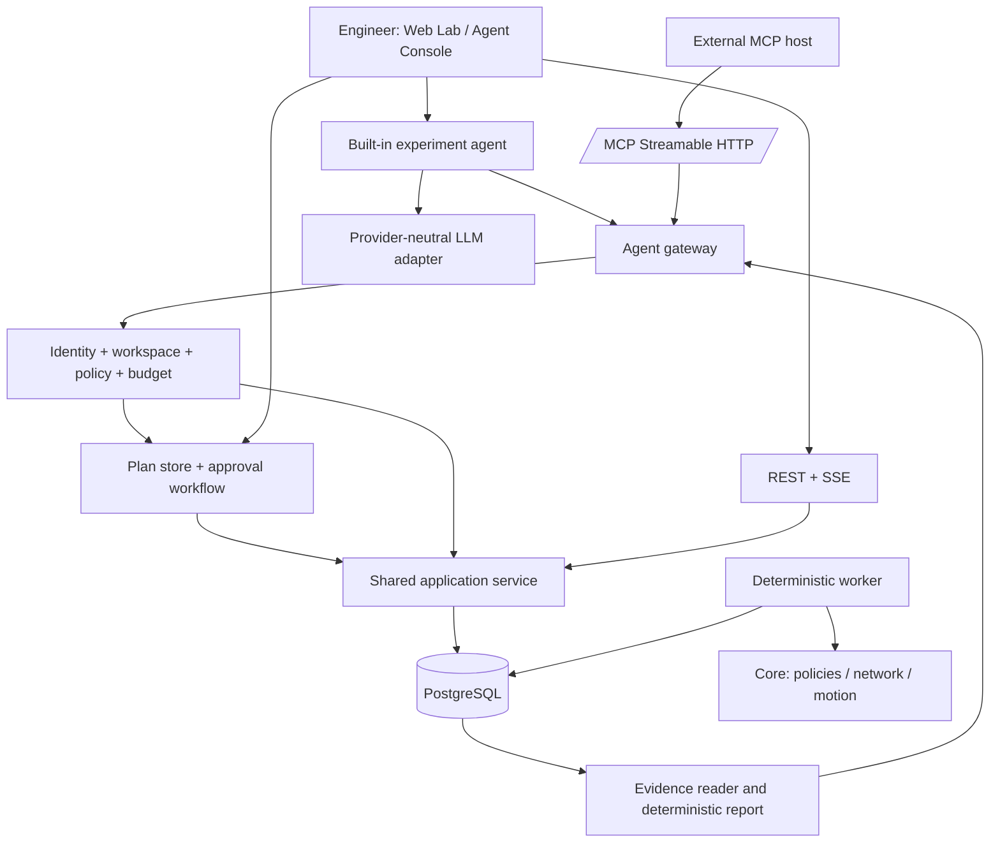

# Agentic platform architecture (proposed R6 / MVP requirement)
This supersedes the previous optional read-only assistant scope, only for simulated experiment planning and execution. The deterministic Core remains the authority for every simulated task, robot move, lease and recovery. Agent outputs are proposals, not facts or instructions to robots. MCP is an interface to SwarmForge application services, not a replacement for REST or a robot protocol.

## Architecture

Deploy in existing API process (module boundary, not microservice), worker separate as already planned. The gateway is tool authorization/orchestration, not LLM API proxy, not an arbitrary outbound MCP router. Model adapter is separate and replaceable; one configured provider in MVP, no mandatory model subscription. External MCP host supplies its own model, bypasses our provider, never bypasses gateway policy. Use SDK with stable supported MCP revision, pin version; at design time official 2026-07-28 specification is published. Test protocol negotiation/headers, errors, tools/list, tools/call and client interoperability; support older revision only if actually tested. Reference: https://blog.modelcontextprotocol.io/posts/2026-07-28/ and https://modelcontextprotocol.io/specification/ . Do not invent a custom JSON REST endpoint and label it MCP.

## Agent capabilities and user value
| Capability | Inputs | Output | Authority |
|---|---|---|---|
| Scenario planner | natural language goal, approved preset/revision, constraints | typed validated scenario patch, explicit assumptions | draft only |
| Experiment planner | objective, allowed policies, seeds, time/robot limits | immutable plan of scenario revision(s), algorithms, seeds, predicted run count | draft only |
| Experiment operator | human-approved exact plan ID | durable run or benchmark IDs | bounded write, once per approved plan |
| Evidence investigator | stored metrics, event ranges and manifests | structured findings with source IDs, caveats | read only |
| Report assistant | evidence bundle, research question | explanatory narrative and recommended next test | read only; no fabricated metrics |
These can be phases of one bounded orchestrator, not five autonomous LLM services. No LLM in simulation or direct database/worker access. No tool capable of shell, arbitrary network, secrets, physical robot command, deletion, arbitrary SQL, provider switching, uncontrolled spending or background loops.

## Internal agent state machine
1. User selects workspace, goal, preset/revision and maximum run count. Agent obtains capabilities and relevant scenario metadata from authorized tools.
2. Model produces typed plan (schema from contracts/agent-tools.json), no executable code. Gateway validates config via canonical scenario validator, allowed algorithms, limits, unique seeds, revision/hash, cost estimate in run units, expected output and required permissions. Plan has immutable hash, expiry and owner. Draft plan may contain a validated scenario config not yet saved; approval includes exact config hash. No mutation of canonical scenario until execute; UI previews the config and diff.
3. User reviews exact plan in trusted web UI; editor/owner approves or denies through authenticated REST with CSRF protection for cookies. Agent/MCP cannot approve its own plan. Approval is bound to principal, workspace, plan hash, engine build, scope, expiry, max runs. Approval changes only status, never plan content. Modified plan must be newly approved.
4. Gateway execute tool checks principal, editor role, approved status, hash, expiry, quota, engine version and idempotency atomically. Materialize any approved draft scenario as immutable revision and enqueue single run or bounded benchmark(s) through same app transaction. No direct engine invocation or hidden extra jobs. Duplicate execution returns same IDs; approval is consumed in same transaction. Failed enqueue rolls back. Approval expiry before execution fails closed.
5. Worker executes deterministic jobs; gateway polls status with bounded interval, no busy loop. External tools return handles promptly; no MCP Tasks extension dependency. User can inspect SSE in web. Cancellation uses manual REST; agent does not auto-cancel.
6. Report derives deterministic numeric metrics, comparisons, trace hashes and event references from committed evidence; optional LLM explains only those facts with citations. Claim references resolve to run ID + seq or metric key + manifest hash. Distinguish hypothesis, measured result and missing evidence; reject unverifiable numeric claims or display unverified narrative separately. If LLM unavailable, show deterministic plan/result export and allow manual form.
7. Record audit trail; user can follow proposed next experiment but every execution needs new approval. No autonomous retry of jobs or continuous monitoring in MVP.

## Endpoint boundaries (proposed, not implemented)
Canonical existing REST remains under /api/v1/workspaces/{workspace_id}; R6 adds additive agent OpenAPI operations:
| Method | Path suffix | Meaning |
|---|---|---|
| POST | /agent/plans | Create typed immutable plan draft, editor; idempotency required |
| GET | /agent/plans/{plan_id} | Retrieve scoped plan and status |
| POST | /agent/plans/{plan_id}/approve | Human web approval only, editor/owner; body includes expected plan hash |
| POST | /agent/plans/{plan_id}/deny | Human denial only; expected hash |
| POST | /agent/plans/{plan_id}/execute | Execute approved exact plan once; idempotency |
| POST | /agent/sessions | Start bounded interactive agent request for goal; optional provider |
| GET | /agent/sessions/{session_id} | Poll phase, plan ID, errors and evidence result |
| GET | /agent/reports/{benchmark_id} | Deterministic comparison and citations; optional separately labeled summary |
MCP endpoint proposed at /mcp (Streamable HTTP), protected resource metadata via SDK/authorization provider as applicable. No separate HTTP URL per tool; JSON-RPC tools/list and tools/call are protocol methods. Contract file lists tool input schemas and result shape requirements. Read tools scoped per principal; write tools require editor + prior approval. Do not expose approve/deny, secrets or physical control via MCP. Plan approval URL is same trusted app origin and plan ID; don't put bearer tokens in URLs. R6 must add actual OpenAPI schemas, SQL migration, MCP tool output schemas and generated clients in one reviewed contract-first change. Current 31-operation OpenAPI unchanged by this docs PR; the 8 proposed additions are not available now.

## Security / budget / persistence
- Every tool invocation resolves authenticated principal and workspace membership, including resource IDs; never accept model-supplied role/identity. Scoped access tokens verified issuer, audience, expiry and scopes; no token passthrough to LLM provider. HTTP transport Host/Origin and DNS rebinding protections; OAuth discovery/401 challenge for remotely exposed MCP per pinned spec. Local dev can use isolated seeded principal only on loopback. No public anonymous write endpoint.
- Allowlist exact tool names, JSON Schema validation, max payload 256 KiB, max event query 200 rows, output truncation with continuation; rate limit per principal/workspace. Defaults: max 12 runs per approved plan, 100 robots/run, 10000 logical ticks, max 2 active runs/workspace (consistent with existing queue), max 12 model/tool orchestration steps, 120 seconds model interaction budget, configurable token cap and provider cost cap (no paid call without configured cap). Enforce quotas transactionally; fail closed. Polling long jobs is user driven or bounded session, no promise of completion within model deadline.
- Treat user content, scenario labels, event strings, external tool response and model output as untrusted data. No automatic instructions from retrieved evidence. No raw secrets, cross-workspace context, prompt logs or hidden system prompt disclosure. Model receives minimal bounded evidence only, provider use explicitly disclosed.
- Add agent_plans (workspace/id, actor, plan_json/hash, status, created/expires, engine_version), agent_approvals (workspace/plan, approver, approved_hash, decision, time, consumed_at), agent_sessions (workspace/id, principal, status, bounded step budget, plan_id), agent_tool_audit (workspace/session, actor, tool, request_hash, result refs, outcome, timing, redacted metadata). Composite workspace FKs, unique execution per plan, lock plan row before enqueue, approval status and results atomic. Existing audit_log remains system audit; no raw prompts by default. SQL migration in R6, no second store. Retention configurable; approval/audit retention aligned with runs; protect deletion during active jobs. Session logs no secret tokens.
- External MCP read and execute require same application service authorization as REST; tool hints are not access control. Agent cannot approve; human UI must show exact task count, faults, policies, scope and side effects. User can always deny and inspect existing evidence.
- Verify malicious tool inputs, prompt injection, approval replay and expiry, unauthorized reads/writes, cross-workspace ID, role downgrade after approval, run quota races, provider timeout, model malformed output, MCP transport negotiation, evidence reference integrity and manual no-key operation.

## Agentic product differentiation
The agent translates a reliability question into a controlled, auditable experiment and explains measured tradeoffs. The gateway turns model intent into constrained, approved application commands. The MCP endpoint makes the same capability available to an external host without coupling to a specific LLM. The robotics algorithm remains a separate research contribution; MCP/LLM integration alone is not scientific novelty. Measure agent value separately (time to configure, plan validity, evidence citation accuracy, denial/replay success), not robot throughput improvement due to AI. Compare manual and agent-created identical plans by manifest/digest.
