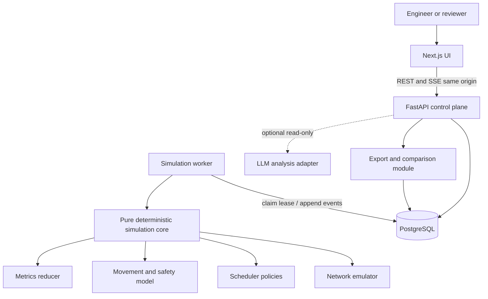
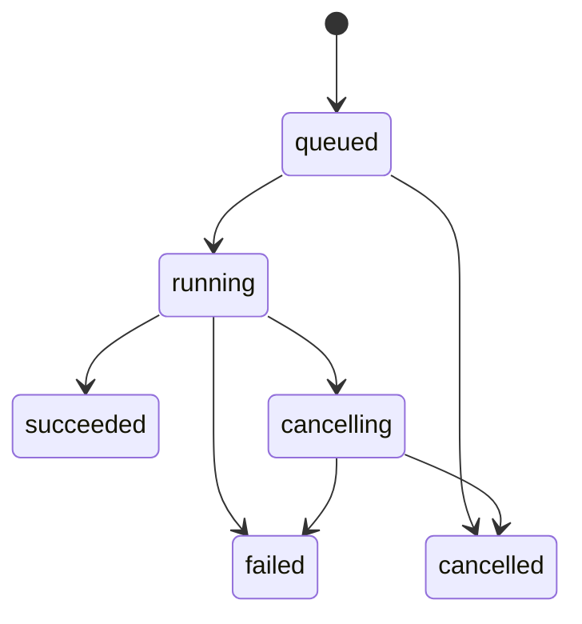

# System architecture and ADRs
Status: proposed, v1.0. Single region, simulation only. No LLM or database round trip in robot control loop. Use Python 3.12+ with pinned dependencies, FastAPI/Pydantic, SQLAlchemy/Alembic or explicit SQL migration runner (choose one; SQL is canonical), PostgreSQL 16+, Next.js/TypeScript/Canvas, pytest/Hypothesis, Docker Compose. No Go, Redis, Kafka, Kubernetes or GPU required for MVP.

## Context and containers

Browser never talks to DB, worker or robot. Reverse proxy routes /api/v1 and /health to API; SSE buffering off, same origin cookies or bearer auth. API validates commands and persists jobs; does not execute simulations in request handlers. Worker is a second process using same Python package. CLI calls same pure engine without DB; converts result to same manifest/event format. Engine uses an injected virtual clock and deterministic PRNG; no wall time, DB, filesystem, LLM or global randomness inside policy code. DB stores durable evidence; UI state is derived and never authoritative.

## Modules / repo layout
```text
apps/web/                        Next.js application
services/swarmforge/
  pyproject.toml
  src/swarmforge/
    api/                         routes, auth, errors, DTOs
    application/                 commands, use cases, job orchestration
    domain/                      types, invariants, state transitions
    core/                        clock, event engine, simulator, seeded RNG
    policies/                    centralized, local_auction, scoped_lease
    network/                     directed links, delivery, faults
    motion/                      grid, space-time A*, reservations
    persistence/                 repository adapters, transaction/lease handling
    worker/                      job loop, cancellation, telemetry
    benchmark/                   manifest, metrics, paired aggregation
    cli/                         run, benchmark, replay
    analysis/                    optional read-only report assistant
  tests/{unit,property,integration,e2e}/
contracts/                       canonical OpenAPI and engine event version
db/                              canonical SQL migrations
examples/                        versioned scenario fixtures
infra/                           Compose, proxy, environment example
docs/                            architecture and ADRs
AGENTS.md
```
Dependencies: API -> application -> domain; worker -> application/core; core -> domain and policy/motion/network ports; persistence implements application ports; domain never imports framework. Generated TS client/types consume OpenAPI; engine JSON serialization validated at boundary. Avoid generic abstractions without second implementation.

## Domain ports
ScenarioRepository.get_revision(workspace,id,version); RunRepository.create/claim/commit_batch/fail/reap/cancel; EventReader.read_after(run,seq,limit); ExperimentService.expand(manifest); Policy.on_tick(LocalView,Inbox,Tick)->Decision[]; Network.send(sender,recipient,payload); Motion.plan(grid,local view,horizon)->Path; SafetyArbiter.resolve(proposals)->Moves; MetricsReducer.apply(event); Clock.schedule(tick,phase,seq,payload). Policies may only receive their local state/messages. Safety arbiter has simulated physical truth to prevent collisions for all methods equally; never leaks global task or network state to policies. This is a modeling assumption, not a deployed safety guarantee.

## Deterministic event loop
Each integer tick: apply scheduled faults/commands; deliver due messages after checking link state; release work; apply expiry/crash-stop transitions; call policies in sorted robot order; schedule outgoing messages (minimum 1 tick); validate authority and movement; apply allowed moves; process pickup/dropoff; collect metrics/events; optionally snapshot. Tie-break by stable entity ID, event sequence and fixed phase. Independent random streams for workload and network (seed derived by SHA-256 of master seed + stream name); keyed random draws by tick/link/message class/ordinal where feasible, so algorithm message count cannot change the external workload or fault schedule. Stable sorted serialization and integer costs for deterministic digests. Simulated timestamps are ticks; wall timestamps only for DB/audit. Exclude run IDs, wall times and progress frames from semantic digest.

## Persistence, run lifecycle and concurrency

Job table is runs. Claim queued with SELECT FOR UPDATE SKIP LOCKED in short transaction, set worker_id, lease_token UUID, lease_until (DB time), status running; every batch locks run row and verifies token/status/lease. Worker renews 30-second lease every <=10 seconds wall time, including compute loops. Each transaction appends contiguous event seq, snapshots, command applied ticks and progress atomically; terminal metrics and status committed together. Worker cancellation requested via API sets cancelling; worker checks at tick boundary and finalizes cancelled. Sweeper marks expired running/cancelling failed (worker_lost); no silent resume or retry; explicit rerun creates new run. Old worker cannot publish after fencing. A stale terminal run never changes. One writer per run, event IDs gap-free by committed batch. Local simulation uses bounded batches (e.g. 100 events or 200 ms), snapshots at configurable tick interval; do not persist every position each tick if not necessary, use movement events and periodic snapshots. No unbounded queues. Client reconnects from last committed event.

Benchmarks expand scenario revision x policies x seeds in a transaction. Limit 120 child runs per benchmark and workspace quota. Children run independently. Benchmark status derived from child statuses: queued, running, succeeded (all success), failed (all terminal and any failed), cancelled (all terminal, none failed and any cancelled). Cancel requests cancel queued children or transition running to cancelling in one transaction. No separate scheduler truth. Results preserve failed runs; exclude from numeric pairing explicitly with counts. 
Interactive commands: lock run, reject terminal/cancelling or scripted; queue validated command with monotonic per-run command_seq; worker samples pending commands at tick boundaries, records actual tick and emits fault events in same commit. No retroactive fault application. Replay UI is event-log playback; reproducibility rerun is only guaranteed for scripted runs; optional materialize applied interactive commands into a new revision (P1).

## Threat model and access
Roles owner/editor/viewer. Every resource lookup includes workspace; membership checked server-side on every endpoint, including SSE and export. Demo mode explicit local-only environment flag with seeded identity; fail closed if DEMO_MODE on non-loopback deployment unless dedicated isolated demo with no sensitive data and strict quotas. Production OIDC verified issuer/audience/expiry or trusted server session, no homemade JWT; no token in URLs; same-origin HttpOnly Secure SameSite cookie + CSRF on mutations, or bearer header. API CORS allowlist, request body limits, safe JSON, rate limit, per-workspace concurrency (2 default) and global quota. Enforce concurrency under transaction/advisory locks, not check-then-insert. No untrusted code/plugin execution, arbitrary URLs, shell invocation or filesystem paths. Exports sanitized against CSV formula injection; fixed filenames. Secrets server env, logs redact. AI reads scoped metrics and event IDs; proposed R6 gateway also permits bounded simulated experiment enqueue only after exact human approval; no robot control or arbitrary tools; treat scenario names/content as untrusted; label generated hypotheses, link evidence. Public demo read-only or isolated workspace. Audit role changes and run/fault submissions. RLS can be added later as defense in depth; do not claim it exists. No safety certification, privacy guarantee or SLA.

## Deploy and operate
Local Compose: postgres persistent volume; API and worker same pinned image different commands; web build; proxy optional. Health: /health/live process, /health/ready DB and schema for API, worker heartbeat via metrics; DB readiness dependency. Environment: DATABASE_URL, AUTH_MODE, OIDC_ISSUER, OIDC_AUDIENCE, DEMO_MODE, API_BASE_URL, MAX_ACTIVE_RUNS, MAX_WORKSPACE_RUNS, RUN_LEASE_SECONDS, EVENT_RETENTION_DAYS; .env.example placeholders only. Run DB migration as one-shot before starting API. Cloud deploy only after local smoke test; one VM/container host with persistent Postgres or managed DB, avoid relying on expired credits. TLS, non-root images, read-only FS except required temp, backups and restore drill. Logs structured request_id/workspace_id/run_id/event type, never secrets. Metrics job queue age, active jobs, lease expiry, event batch latency, SSE reconnects, engine ticks/sec, invariant violations. OpenTelemetry optional, not a blocker. CI dependency lock, lint/typecheck, tests, migration on clean DB, contract check and smoke benchmark. Data retention default 30 days for demo logs with explicit purge job; production opt-in policy/export before deletion; manifests kept until workspace deletion. Backups and disaster recovery not validated. Scale path: increase worker replicas; split event store/object artifacts when proven necessary, not now.

## ADR summary
ADR01 Python core/worker over Go split: research speed and single implementation. ADR02 PostgreSQL durable queue over Redis: atomic job/results and fewer dependencies. ADR03 discrete grid and integer virtual clock: repeatability, no physics claim. ADR04 REST+SSE: one-direction events, reconnect; commands REST. ADR05 deterministic authority and safety, LLM advisory only. ADR06 immutable revision+manifest, new run for retry. ADR07 partition safety over universal liveness: isolated work only when pre-authorized. ADR08 simulated physical arbiter common to all policies; no physical control. ADR09 public API version v1 and versioned engine events; changes additive or new version.

## ADR10 — Agentic release scope amendment (proposed)
Add bounded agent orchestration and MCP adapter inside API process, sharing application services and workspace authorization. Human-approved immutable plan is the only agent mutation authority; no LLM in Core. Separate provider adapter from agent gateway, preserve manual operation without provider. See agent-platform.md for proposed endpoint/tool/security contracts. No new services or databases. Original API and SQL unchanged in R0; R6 implements additive contracts and migration.
