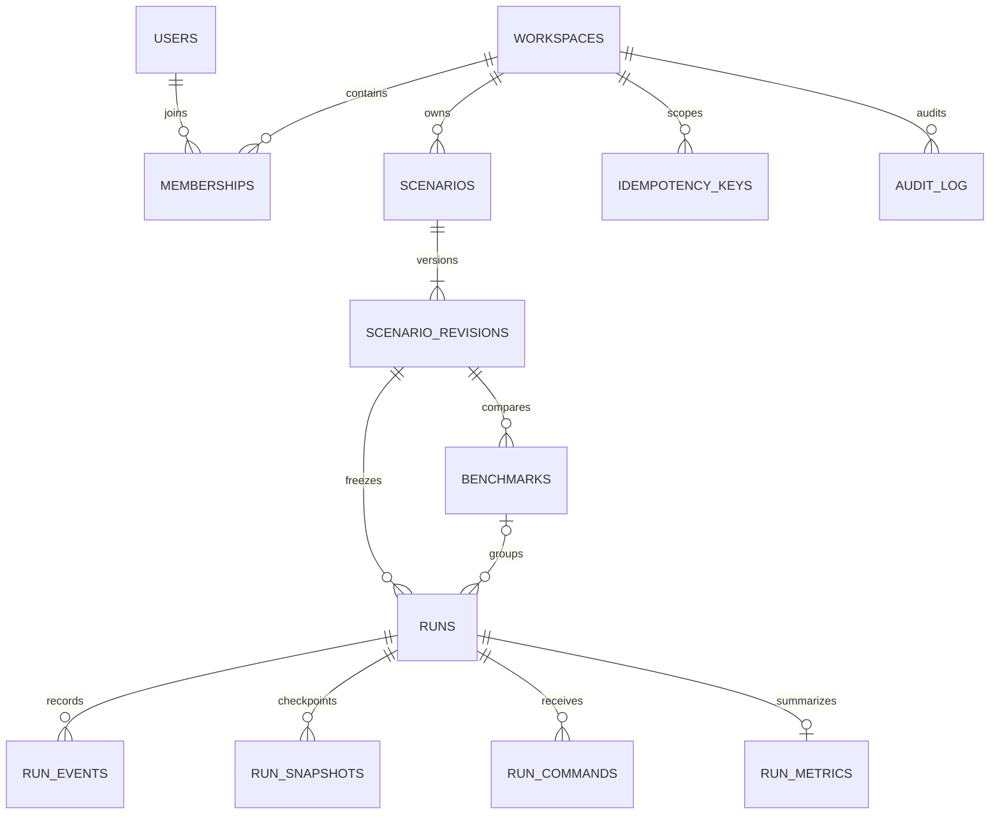

# Database design
PostgreSQL, UUID external IDs generated by application (schema defaults gen_random_uuid), timestamptz for wall clock, bigint integer ticks/seq, JSONB for versioned immutable config and event payloads, typed relational ownership and run lifecycle. SQL migration in ../db/001_initial.sql. Database is durable control plane, not simulated network or robot coordination authority.

| Table | Key and responsibility |
|---|---|
| users | id; unique issuer+subject; never store password |
| workspaces | id, name, owner through membership |
| memberships | workspace_id,user_id; role |
| scenarios | workspace_id,id; name and archive flag; active revision derived by max |
| scenario_revisions | workspace_id,scenario_id,version; config, canonical sha256, author |
| benchmarks | workspace_id,id; revision FK, algorithms, seeds, engine version |
| runs | workspace_id,id; revision FK, benchmark optional, policy, seed, immutable manifest/hash, lifecycle, fencing, seq/tick |
| run_events | workspace_id,run_id,seq; tick, event_type, payload, schema_version |
| run_snapshots | workspace_id,run_id,seq; tick, state; FK to matching event; initial snapshot seq 1 |
| run_commands | workspace_id,run_id,command_seq; payload, status, applied_tick, actor |
| run_metrics | workspace_id,run_id; aggregate counts, derived measures, trace digest, JSON breakdown |
| idempotency_keys | workspace_id,actor_id,operation,key; request_hash, response body/status, expiry |
| audit_log | workspace_id,id; actor, action, resource, request ID, timestamp |

Robots/tasks/assignments/faults are simulation domain objects inside immutable scenario configs, event payloads and snapshots; not mutable global DB tables. This prevents cross-run contamination and SQL from acting as a hidden oracle. Use schema validation for JSON; future materialized projections can be derived from events. 
All composite FKs include workspace_id, benchmark FK also includes scenario+revision to ensure matching experiment inputs. API auth still mandatory. Snapshot state at seq must reflect events through seq; event append and snapshot in same transaction. Initial event run.started seq 1 with initial snapshot; queued run snapshot endpoint returns 409 until initialization; no event stream required for queued runs (poll GET run or open stream and wait). 
Revision allocation lock scenario row then SELECT max+1 in transaction; archive hides from default lists, retains history. No hard delete through v1. 
Idempotency: lock per (workspace, actor, operation, key), request hash canonical normalized body; same key/body returns stored response, different hash ->409, expiry 24h. Insert result and resource transactionally. Use database time for lease, not virtual time. Fencing update requires matching lease_token, status and unexpired lease; lock run and verify before writing events. 
Indexes: active run queue partial on created_at; benchmark children; workspace status/time; run events PK supports cursor; snapshot index via PK; pending commands partial. Do not create GIN indexes until query evidence. DB check constraints complement application validation; no RLS in initial migration; workspace authorization tests mandatory. Run event retention only purge terminal runs after export/retention policy, use controlled admin job and preserve manifest/metrics as appropriate. Backups, schema migration rollback via restore for destructive changes; test migration on clean PostgreSQL.
