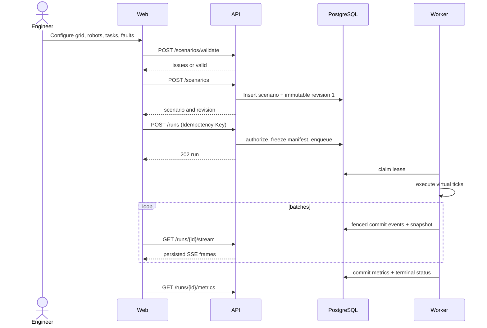
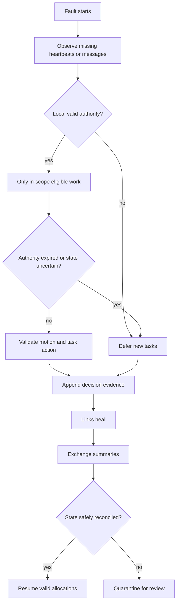

# End-to-end workflows

## 1. Configure scenario and launch

Validation: bounds, unique robot/task/link IDs, starts free/unique, all coordinates legal, task release < duration, end > start, target exists, fault overlap, reachable pickup/dropoff ignoring other robots, limits; return JSON pointers. Save revision as append, no mutable running configs. Launch from saved revision, explicit algorithm and integer seed. Run creation freezes engine_version, config hash and inputs. Show queued status, then running and actual progress. On reload fetch snapshot and subscribe after its seq; reducer dedups seq. On error show trace/request ID; no simulated success. 

## 2. Failure recovery

Faults change network/robot world first; policy detects indirectly via heartbeat timeout (3 ticks default). No privileged instant notifications except local crash state and own messages. Live injection only in interactive mode; POST command returns queued, event later records actual applied tick. If command arrives after run end mark rejected; never silently apply. Fault scheduling and replay use logical ticks.

## 3. Benchmark
Select one saved revision, 2–3 policies, explicit unique seed list. API checks total <=120 children and inserts all manifests/queued runs atomically. Progress from child terminal counts; comparison includes matched successful seeds and missing/failed counts, no cherry-picking. Report mean/median, paired difference and uncertainty; result link drills into raw run. Cancel benchmark atomically requests cancellation for all nonterminal children; completed children remain. Export CSV/JSON and manifest. 
## 4. Audit and replay
GET run snapshot returns complete state at seq and tick (robots, tasks, network, metrics); GET events after seq provides ordered changes. Client renders interpolated visual positions only, cannot change simulation. SSE resumes with Last-Event-ID; if seq too old or greater than latest return reset-required before stream; fetch snapshot again. Terminal run can replay from beginning with events and checkpoint snapshots. Scripted rerun POST /runs with original scenario revision/algorithm/seed; same engine build required. Interactive rerun requires applied command trace converted to scripted config (P1).
## 5. Operational recovery
Worker crash -> lease expires -> reaper fences and marks failed -> UI shows reason -> operator starts new run from same manifest. API restart -> existing jobs durable -> stream reconnect. DB outage -> stop publishing, do not assume writes succeeded; worker rechecks lease and fails if lost. Browser disconnect never cancels run. Cancellation cooperative at tick boundaries; terminal no-op conflict. Quotas and bad input rejected before enqueue. 
## 6. Competition walkthrough
Open preset warehouse; run centralized normal, then identical faulted scenario and policies; show network split, stopped/deferred tasks, valid local work, heal, recovery; compare actual metrics, inspect rejected stale decision; export reproducible manifest. If no improvement measured, state that and explain tradeoffs. Do not use animation-only demo as evidence.
